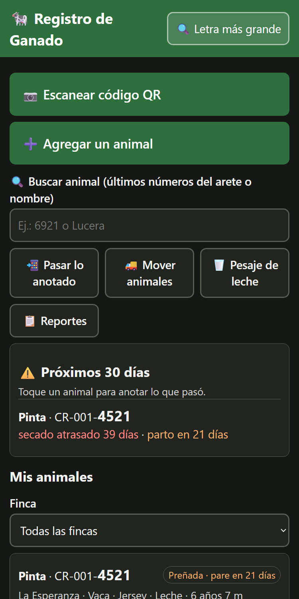
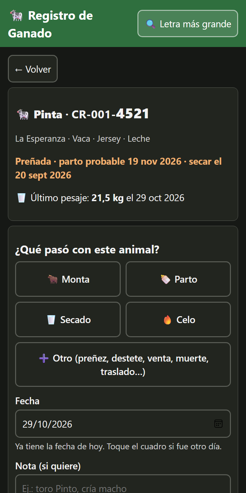
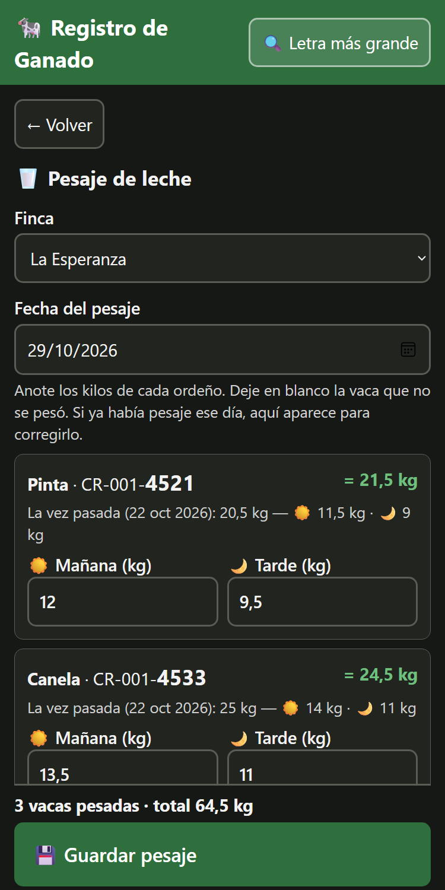
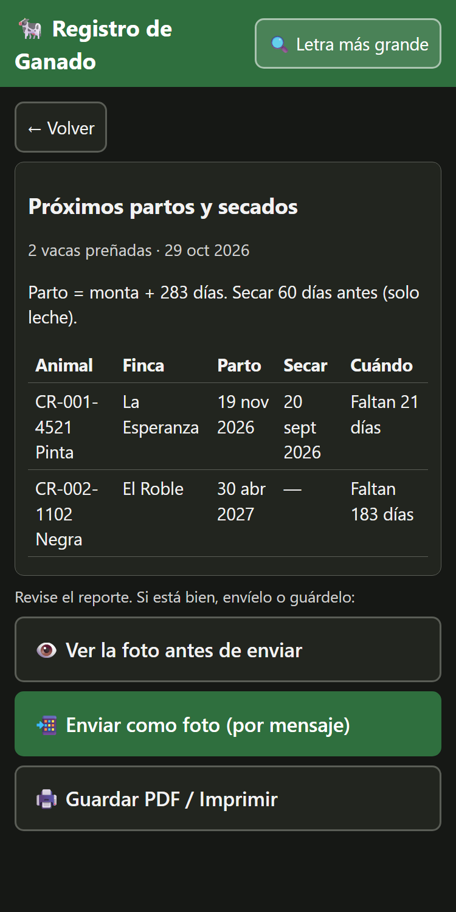

# Registro de Ganado

App gratuita y sencilla para llevar el registro del ganado de una finca desde el celular, incluso sin señal en el campo.

**Usarla:** https://xdextx.github.io/control-ganado/ — ábrala con señal una vez y agréguela a la pantalla de inicio del teléfono.

La usa una finca familiar de ganado de leche y carne.

### Agregarla a la pantalla de inicio

Abra el enlace con señal, espere a que cargue y siga los pasos de su navegador. Después ábrala siempre desde el ícono: funciona sin señal.

| Navegador | Pasos |
|---|---|
| **Chrome** (Android) — recomendado | Tres puntitos **⋮** arriba a la derecha → **Agregar a pantalla principal** (o **Instalar app**) → **Instalar** |
| **Samsung Internet** | Menú **☰** abajo → **Agregar página a** → **Pantalla de inicio** |
| **Edge** (Android) | Tres puntitos **…** abajo → **Agregar al teléfono** (o **Agregar a pantalla de inicio**) |
| **Firefox** (Android) | Tres puntitos **⋮** → **Instalar** (o **Agregar a pantalla de inicio**) |
| **Opera / Opera GX** | Menú → **Agregar a…** → **Pantalla de inicio**. Ojo: en Opera no se descarga bien la copia de seguridad y el ícono puede abrir varias ventanas; mejor use Chrome |
| **Safari** (iPhone) | Botón **Compartir** (cuadro con flecha ↑) → **Agregar a inicio** → **Agregar**. En iPhone solo funciona desde Safari |

Si el teléfono pregunta si el navegador puede agregar íconos, toque **Permitir**.

**Cada navegador guarda sus propios datos.** Si cambia de navegador, antes pase sus animales: en el viejo, **⚙️ Copia de seguridad → ✉️ Enviar la copia como texto**; en el nuevo, péguela en **Pegue aquí una copia recibida como texto**.

<p>
  
  
  
  
</p>

> **In English:** an offline-first livestock register for a family cattle farm, built for users aged 60+ (large buttons, plain Spanish, adjustable text size). It is a Vite + TypeScript PWA with a custom TSX runtime (no UI framework), a cache-first service worker, and data kept only in the phone's `localStorage`: no server, no accounts. Phones sync by QR code or backup file with a merge that never deletes data, and incoming data is validated before it is stored. It covers calving and drying-off alerts, milk weighing, moving animals between farms, and reports as images or PDF. Includes unit tests (vitest), CI deploy to GitHub Pages, a [security audit](docs/auditoria.md) and a [developer guide](docs/desarrollo.md) (in Spanish).

## Qué hace

- Registro por número de arete, nombre, finca, raza, sexo y categoría.
- Eventos fechados: celo, monta o inseminación, preñez, parto, aborto, destete, secado y salida (venta, muerte o baja).
- Avisos de fecha probable de parto (monta + 283 días) y de secado (60 días antes del parto, en ganado de leche).
- Reportes por finca, partos y secados, y salidas del mes: se envían como foto o se guardan en PDF.
- Copia de seguridad en archivo y paso de datos entre teléfonos con código QR, sin borrar nada al juntar.
- Botones grandes, letra ajustable y textos simples, pensada para personas con poca experiencia en tecnología.

## Privacidad

Los datos se guardan **solo en el teléfono** de quien usa la app. No hay servidor ni cuentas: nada se envía a internet. Por eso es importante guardar una copia de seguridad de vez en cuando.

## Comentarios

Dentro de la app, al final de la pantalla principal: **“💬 Enviar comentarios o ideas”**, o escriba a germonram@gmail.com. También puede abrir un reporte en la pestaña *Issues* de este repositorio.

## Para desarrollar

Requiere Node 22.12 o superior.

```bash
npm install
npm run dev      # servidor local; catálogo de componentes en /storybook
npm test         # pruebas
npm run build    # versión para publicar (carpeta dist/)
```

Hecha con Vite y TypeScript, con TSX propio sin librerías de interfaz (`src/jsx.ts`). Cada vez que se sube algo a `main`, una acción del repositorio corre las pruebas y publica la página.

## Documentación

- [Manual de uso](docs/manual-usuario.html), para las personas que llevan el registro.
- [Manual para desarrolladores](docs/desarrollo.md): arquitectura, modelo de datos, sincronización, seguridad y cómo publicar.
- [Auditoría de fallos y vulnerabilidades](docs/auditoria.md).

## Licencia

[MIT](LICENSE)
